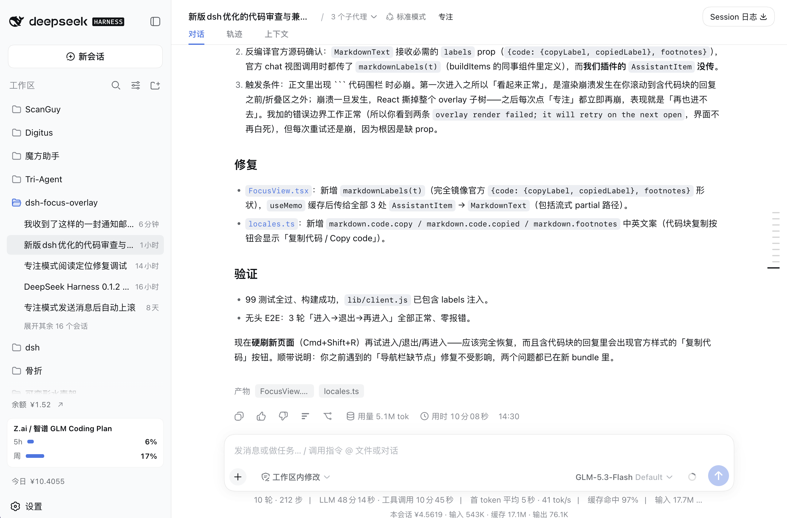
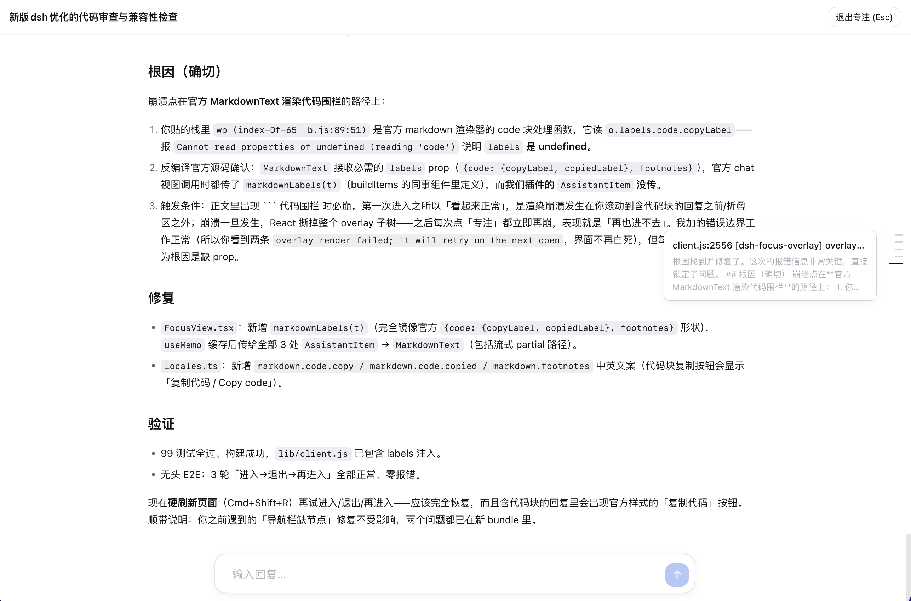

<h1 align="center">dsh-focus-overlay</h1>

<p align="center">
  <a href="README.md">中文</a> | English
</p>

<p align="center">
  A <b>focus mode</b> for the DeepSeek Harness (DSH) web GUI and the macOS / Windows desktop app: one click to a full-screen reading overlay that hides the header, composer and sidebars, folding the AI tool-call flow into official-style count summaries — leaving only the conversation between you and the AI.<br>
  Text, images, the turn rail, width handles and the answer card all reuse or 1:1 replicate official components, matching the chat view's look.
</p>

<p align="center">
  <a href="https://www.npmjs.com/package/dsh-focus-overlay"></a>
  <a href="https://www.npmjs.com/package/dsh-focus-overlay"></a>
  <a href="https://github.com/boogoo619/dsh-focus-overlay/blob/master/LICENSE"></a>
  <a href="https://github.com/boogoo619/dsh-focus-overlay/blob/master/package.json"></a>
  <a href="https://github.com/awesome-dsh-plugin/awesome-dsh-plugin"></a>
</p>

## Features

- **Full-screen reading** — an overlay registered additively into `shell.overlay`, covering header / composer / sidebars, giving all vertical space to the conversation
- **Folded tool calls** — an assistant turn collapses into one official TurnProcess-style count line, clickable to expand the full work detail
- **Turn navbar** — a right-side rail 1:1 replicating the official TurnNavigator: one mark per turn, hover previews, click to jump
- **Bottom dock** — a compact input bar appears at the live edge and shares the main composer's draft; AI questions and approvals expand into an in-place answer card, so you never leave focus to reply
- **Auto-focus & reminders** — after a reply completes normally, optionally auto-enter focus at your question; while in focus, get a toast for a new reply or when the AI is waiting on you
- **Width handles** — draggable strips beside the content column (official WidthHandle replica) that resize the reading column live and persist
- **Hotkey F** — press `F` anywhere to enter focus mode instantly (toggleable in settings); typing in an input never triggers it
- **Desktop window chrome** — adapts to the dsh desktop app (macOS / Windows): the focus title row is merged into the official frame clearance (48px macOS traffic lights / 40px Windows native titlebar), so the title and exit control share one line with the window controls and the whole row drags the window — no extra blank band above it; native fullscreen keeps a compact 40px title row
- **Focus counter** — the settings card keeps a running total of your focus-mode entries; past 100 entries a GitHub Star nudge appears, is remembered after the first use, and then becomes a direct "open the project page" button

These features are designed to give **small screens** more content space: tucking away the persistent header/composer and tool steps lets the conversation use as much of the screen as possible.

## Screenshots

**Off — the normal chat view**



**On — focus mode**



<!-- Drop your screenshots into screenshots/:
     - before.png — the normal chat view (header / composer / tool cards)
     - after.png  — focus mode (full-screen overlay + summary line + right-side navbar + bottom dock)
     Optionally add navbar.png / card.png as navbar and answer-card close-ups. -->

Once in focus mode, an assistant turn no longer shows every step — it folds into a single official-style count line:

> 12 tool calls · 4 messages · 1 subagent

Click the line to expand that turn's full work detail (per-category one-line summaries: commands, edits, searches, reads, and more).

## Capabilities

| Feature | Description |
| --- | --- |
| Full-screen overlay | Registered into `shell.overlay` (additive, `replaceRisk: none`) — covers header / composer / sidebar; the thin top bar keeps only the session title and an exit button |
| Official rendering primitives | Assistant text through official `MarkdownText` (GFM + code highlighting + TeX + code copy buttons + footnotes); user messages pick the official user-text projection the running dsh exports: `projectUserText` on 0.1.2–0.2.0 (plain runs plus `@`/`/` reference chips), and the official `UserTextRun` plain run after the 0.2.2 desktop runtime removed that function — a missing projection can never crash the overlay; buttons, modals and icons are all official primitives |
| Desktop window frame | The focus title row and the official window clearance are merged into one band: the overlay reserves ONLY `--dsh-frame-top-clearance` (48px macOS traffic lights / 40px Windows native titlebar), the title and exit control sit inside that row, and the transcript starts right below it — the old stacked 48px title row and the extra 20px dialog gap are gone. The row is the overlay’s last effective drag claim on macOS (Windows keeps the separate `.fm-frame-strip` over the caption band as the overlay’s last child; both carry `data-window-drag` + `-webkit-app-region: drag`), so scrolled content / the turn rail’s no-drag rects cannot cancel the band, while the exit control is explicitly `no-drag` and stays clickable; the title starts at x=88px on macOS to clear the traffic lights and clears the top-right native caption buttons on Windows. Native fullscreen (`data-fullscreen`) keeps only a compact 40px title row. On Windows it also hides the official sidebar-collapse and new-session controls that the window chrome promotes into the titlebar layer when the sidebar is collapsed / the window is narrow — otherwise they painted above the focus layer and a stray click switched sessions while reading; both come back with the chrome on exit. In a plain browser the variables and markers are absent, so the 0px fallback keeps the old pixel-identical layout |
| File-mention chips | Inline-code paths in AI replies resolve through the official `chatFileMentions` into clickable chips: on dsh 0.2.x the overlay passes the same real Turn face (`deliverables` projection) the official chat turn tail uses and opens through the sidebar resource controller's `dsh-resource://file/session/…` address; on dsh ≤ 0.1.x it keeps the legacy owner shape and `workspaces.openPath`. No chip without projection data, and a resolver failure never crashes the overlay |
| Image resolution | Assistant `image` blocks resolve through `uiConversation.imageUrl` (the dsh 0.1.2+ session-authorized image cache), falling back to the legacy resolver on older dsh; local images written as Markdown in an AI reply (relative or absolute paths, e.g. ``) resolve to the authenticated file URL with the session `cwd`, using the same rules as the official `fileImages` provider, instead of rendering only the alt text; images attached to a user message render above its bubble too |
| Tool-call folding | Follows the official "transcript view" preference (normal / compact); compact mode folds each turn's work part into a "N tool calls · M messages · K subagents" disclosure line ("Thought for a while" when nothing is countable), clickable to expand the full detail; steering messages always stay top-level, never buried; the last turn stays unfolded while streaming |
| Categorized summaries | The expanded detail counts tools by family: commands / edits / searches / reads / directory listings / subagents / todos / goals / workflows / skills / questions / plans / background jobs / context injections |
| Full-history load | dsh 0.1.2 pages history by turns; opening focus drives `loadOlder` to the session start (bounded, aborted on unmount) for a complete reading view |
| Precise scroll preservation | Opens at the message you're reading in the chat (chat anchor key → `seq`); an anti-drift corrector re-steadies the position against history prepends and async layout shifts |
| Turn navbar (TurnRail) | A 1:1 replica of the official TurnNavigator: one mark per turn, the active mark follows scroll, a hover/focus preview card (1-line prompt + 3-line response), click to jump, 24px fade bands at each end, `prefers-reduced-motion` support; auto-hidden under 2 turns |
| Width handles (WidthHandle) | A drag strip on each side of the column, 1:1 replica of the official WidthHandle: symmetric on both sides (2× outward), rAF-throttled live drag, pointer glow indicator, commit-on-release persisted; 640px floor + 88px edge budget per side |
| Back to latest | A centered "↓" floating button when you scroll away from the bottom with no draft |
| Bottom dock | Five mutually exclusive forms decided by one pure selector: answer card / waiting toast / input bar / collapsed pill / jump-to-bottom; the compact bar appears when you reach the bottom (48px hysteresis band) |
| Shared draft | The bar wires the official per-session input machine (`conversation.input.for`): text typed before entering focus is already here, and text typed here is still in the main composer after leaving; on older dsh without the input service it degrades to a plugin-local draft |
| Input bar details | `Enter` sends (queue delivery — queued while the AI runs, with a "Queued N" badge), `Shift+Enter` newlines, IME-composition safe, auto-growing; send failures surface an error line; a draft containing references/commands warns to edit outside focus mode; with a draft, clicking the conversation folds the bar into a blue-dot pill, one click back with the caret in place |
| Reveal-on-send | After sending a long message from the live edge, the view scrolls up just enough to fully reveal the row — never hidden behind the dock; sending from up in history never scrolls |
| Answer card (pending interaction) | Built on the dsh 0.1.2 `uiSession` pending-interactions service: the question card replicates the official QuestionComposer (numbered single-select / checkbox multi-select, a "Recommended" badge, custom answers, one batched submit, an "answer everything" nudge); the approval card replicates the PlanReviewPanel warn strip (allow / deny, showing tool name and reason); a rejection keeps its error on the card; older dsh falls back through a legacy adapter |
| Auto-enter focus | After a reply **completes normally**, auto-open focus at your question; abnormal endings (stop / error / max-tokens / interrupt) never fire — the judgement waits for a stable snapshot (streaming tail drained) first |
| Reply / waiting reminders | In focus, a one-shot "New reply ready + View" toast on completion (auto-dismissed after 6s); a question/approval raises "AI is waiting for your reply + Answer", whose button expands the in-place answer card — auto-cleared once answered, never leaving focus |
| F hotkey | Press `F` anywhere to enter focus mode instantly (default on, toggleable in settings); never fires while typing in an input or editable element, modifiers and auto-repeat ignored |
| Focus counter | A row at the bottom of the settings card totals your focus-mode entries (auto-entries included), persisted to `localStorage`; past 100 entries a Star nudge appears — after the first use it is remembered and replaced by a direct "open the project page" button |
| Esc peels layer by layer | Answer card → input bar → focus mode, one layer per press; Esc mid-IME-composition cancels the composition first |
| i18n | Chinese / English copy registered under the `focus` namespace, follows the UI language |
| Plugin configuration | On dsh 0.2 and newer, open this plugin's detail page from the sidebar "Plugins" page — the configuration renders between the package description and its component rows (`plugins.bundle.config`). On dsh ≤ 0.1.x it stays the collapsible "Settings → Plugins → Plugin configuration" card (`settings.plugin.item`). Preferences persist to `localStorage`; the Node half registers the same settings namespace (schemastery schema) |
| First-run onboarding | After installing, the welcome page shows a one-time "Focus Mode" intro (feature overview + in-place configuration) as a `settings.onboarding` step with its own versioned seen-flag; its "open settings" action jumps to whichever configuration surface the running dsh declares |
| Official preference sync | Reads the official "transcript view" preference (normal / compact on dsh ≤ 0.1.x; compact / standard / detailed / verbose on dsh 0.2); flipping it applies immediately |
| Render error boundary | The overlay content is wrapped in an error boundary: one render crash never bricks the Focus button — the next open retries |
| DSH-better-sidebar compatibility | While in focus, a `<body>` marker makes the package stylesheet hide better-sidebar's top-right panel toggles and any open right/bottom panels (and release the squeezed layout); restored on exit |
| Legacy compatibility mode | On dsh < 0.1.2 missing the new services, the overlay degrades gracefully (legacy snapshot adapters) with a one-time console notice — no crash |
| Cross-release primitive compatibility | Official primitives renamed between major releases fall back by availability (dsh 0.2 removed the fixed-size `…14` / `…16` icons in favour of `…Regular` + `size`; the dsh 0.2.2 desktop runtime removed `projectUserText` in favour of `UserTextRun`), so an `undefined` component can never throw React #130 |

## Install

Requires `dsh` (Web CLI or the desktop app, `>= 0.1.2-rc.1`) and, for source installs, Node `>= 22.19.0`.

**From npm (recommended)**

```sh
dsh plugin --profile web add dsh-focus-overlay
dsh web
```

> If `add` doesn't install the latest version, pnpm's `minimumReleaseAge` (minimum release age) security policy is at work: by default it won't resolve a version as `latest` within **24 hours** of publication, falling back to the previous stable release. To install the latest immediately, pin the version explicitly:
>
> ```sh
> dsh plugin --profile web add dsh-focus-overlay@<version>
> ```
>
> Or wait 24 hours, then re-run the plain `add` command.

**From GitHub**

```sh
dsh plugin --profile web add github:boogoo619/dsh-focus-overlay
dsh web
```

> A git install pulls the **source** and builds it in place via the `prepare` script. pnpm ≥10 refuses to run `prepare` until you allow it; the first `add` fails, then follow the `dsh` hint and add the exact package key to that profile's `pnpm-workspace.yaml`:
>
> ```yaml
> allowBuilds:
>   dsh-focus-overlay: true
> ```
>
> Then re-run `add`. **This authorization lets the package's code run on your machine at install time** — only grant it to sources you trust, and pin the commit (`github:boogoo619/dsh-focus-overlay#<sha>`).

Restart `dsh web` after install.

**DSH desktop app (macOS / Windows)**

The desktop app manages plugins itself, no CLI needed: **Plugins → Add plugin** in the sidebar, enter `dsh-focus-overlay` (or a local directory / `link:` path such as `link:/path/to/dsh-focus-overlay`), then configure it on this plugin's detail page. Reload the desktop window (or restart the app) after installing or updating.

Desktop support is verified against **dsh desktop 0.2.2-rc.1**: macOS and Windows share the same Electron renderer and client contracts; the window-chrome differences (macOS traffic lights / Windows native titlebar) are driven by the official `data-platform` / `data-windows-titlebar` / `data-fullscreen` markers, and the plugin adapts through the official frame variables — one install serves both platforms. In focus mode the top of the overlay is a single draggable title row that shares the window-control line (no extra blank band above it); native fullscreen (macOS green button / Windows maximize) tightens it to a compact 40px row.

> The desktop app uses its own `desktop` profile: installing the plugin only into the Web CLI's `web` profile does not install it in the desktop app — add it once on the Plugins page there too.

> **First run**: after restarting, the welcome page shows a one-time "Focus Mode" intro that explains the features and lets you configure them in place; all of these settings can be changed anytime — on newer dsh open this plugin's detail page from the sidebar "Plugins" page, on older dsh use "Settings → Plugins → Plugin configuration".

## Usage

1. Open a session and click the **"Focus"** button in the session header action row (or press `F` — toggleable in settings).
2. You enter the full-screen focus view: the thin top bar keeps only the session title and exit, the conversation only, with tool steps folded into count summary lines; history pages in automatically for the full session.
3. Hover the right-side navbar to preview and click to jump; drag the strips beside the column to resize it live. The compact input bar appears when you reach the very bottom (a "↓" button shows when you scroll away with no draft).
4. Reply right in the bar: `Enter` sends, `Shift+Enter` newlines (queued while the AI runs), drafts shared with the main composer; clicking the conversation folds it into a blue-dot pill. AI questions/approvals raise an "Answer" button that expands the in-place card for options, free text, or approvals.
5. `Esc` peels back layer by layer (answer card → input bar → focus mode); or click "Exit focus" to return — the original UI is untouched.

> **Compatibility note**: if [DSH-better-sidebar](https://github.com/omdsh-dev/DSH-better-sidebar) is also installed, entering focus mode auto-hides its top-right panel toggle buttons and any open right/bottom panels (releasing the squeezed layout); they're restored as they were on exit, without touching that plugin's layout state.

## Settings

**On dsh 0.2 and newer**: sidebar "Plugins" page → find `dsh-focus-overlay` → the configuration shows on its detail page, between the package description and the component rows.

**On dsh ≤ 0.1.x**: sidebar "Settings → Plugins → Plugin configuration" → expand the "Focus Mode" card.

Both locations present the same options:

| Option | Description |
| --- | --- |
| Auto-enter focus mode when the AI finishes a reply | On a normal completion: auto-open at your question when closed, or a "New reply ready" toast when open (default off) |
| Press F to enter focus mode | Press `F` anywhere to enter focus mode instantly; never fires while typing in an input (default on) |
| Sync the current reading position when entering focus mode | Open at the message you're reading; off opens at your most recent question (default on) |
| Show right-side turn navbar | One rail mark per user message (turn) — hover to preview, click to jump (default on) |

> **Text width** is not in the settings card: drag the handles beside the content column while in focus mode to resize it live; the value persists on release (default 760px, minimum 640px).

## License

[MIT](./LICENSE)
