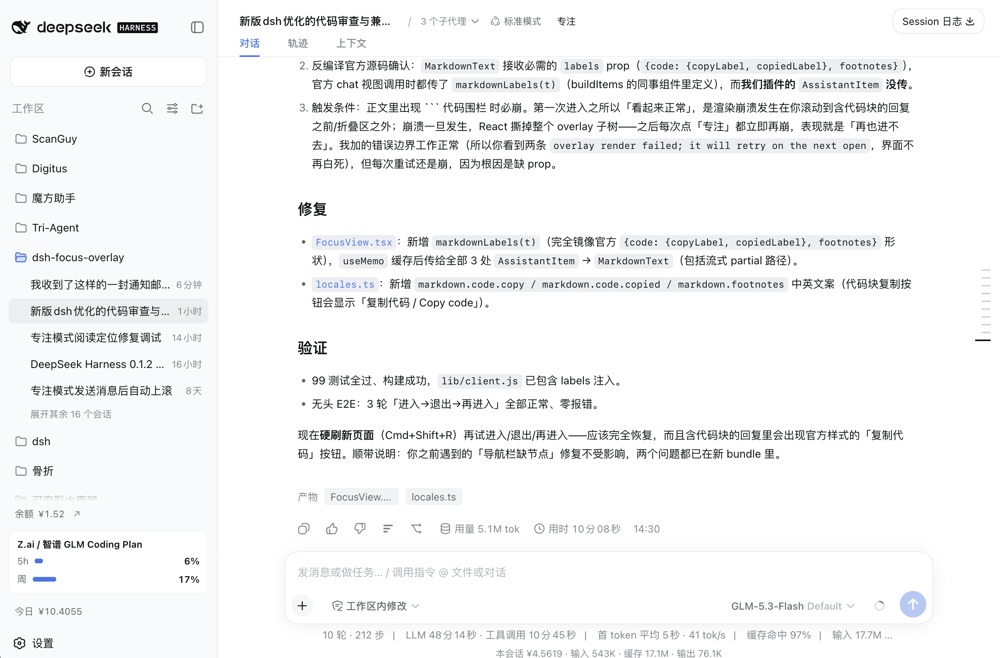
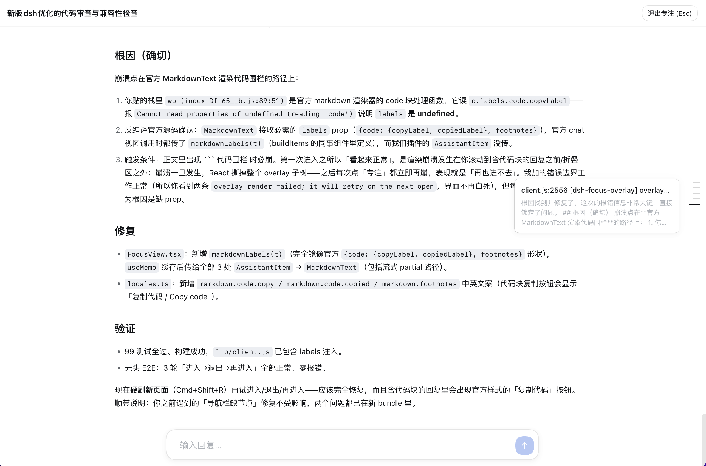

<h1 align="center">dsh-focus-overlay</h1>

<p align="center">中文 | <a href="README.en.md">English</a></p>

<p align="center">
  为 DeepSeek Harness（DSH）Web GUI 提供的<b>专注模式</b>：一键进入全屏阅读遮罩，隐藏标题区、输入区与侧栏，把 AI 的工具调用过程折叠成官方样式的计数摘要，只保留「你与 AI 的对话」本身。<br>
  文本、图片、导航条、宽度调节与答题卡均复用或 1:1 复刻官方组件，观感与聊天视图一致。
</p>

<p align="center">
  <a href="https://www.npmjs.com/package/dsh-focus-overlay"></a>
  <a href="https://www.npmjs.com/package/dsh-focus-overlay"></a>
  <a href="https://github.com/boogoo619/dsh-focus-overlay/blob/master/LICENSE"></a>
  <a href="https://github.com/boogoo619/dsh-focus-overlay/blob/master/package.json"></a>
  <a href="https://github.com/awesome-dsh-plugin/awesome-dsh-plugin"></a>
</p>

## 功能

- **全屏阅读** —— 经 `shell.overlay` 以纯增量方式注册的遮罩，覆盖标题区 / 输入区 / 侧栏，纵向空间尽给对话
- **按需保留界面** —— 四个开关分别决定侧边栏、上方状态栏（会话标题 + 对话 / 轨迹 页签）、下方状态栏（轮次 / tok/s / 缓存命中 / 费用）与工作过程要不要藏起来：想边看会话列表边读长回复，就把侧边栏留着
- **折叠工具调用** —— 一轮 AI 回复折叠成一行官方 TurnProcess 风格的计数摘要，可点击展开完整工作明细；关掉「隐藏工作过程」即完整展示每一步
- **轮次导航条** —— 右侧导航条 1:1 复刻官方 TurnNavigator：每个回合一个刻度、悬停预览、点击跳转
- **底部输入坞** —— 回到最底部出现精简输入条，与主输入框共享同一份草稿；AI 提问 / 审批时原地展开答题卡，作答无需退出专注
- **自动专注与提醒** —— 回复正常完成后可自动进入专注并定位到你的提问；专注中收到新回复、或 AI 等待你回答时弹出提醒
- **宽度调节** —— 正文两侧的拖拽把手（官方 WidthHandle 复刻），实时拖动阅读列宽并持久化
- **快捷键 F** —— 任意界面按 `F` 一键进入专注模式，可在设置中关闭；输入框内打字不会误触发
- **专注计数** —— 设置卡片最底部累计展示你进入专注模式的次数；超过 100 次后出现 GitHub Star 引导，点过一次即被记住，之后提供「前往 GitHub 项目页面」直达按钮

这些功能专为**小屏幕**提供更多内容呈现空间：收起常驻的标题 / 输入区与工具步骤，让有限的屏幕尽可能多地展示对话。

## 效果

**关闭 —— 普通聊天视图**



**开启 —— 专注模式**



<!-- 截图请放到 screenshots/ 目录：
     - before.png —— 普通聊天视图（含标题区/输入区/工具卡）
     - after.png  —— 专注模式（全屏遮罩 + 摘要行 + 右侧导航条 + 底部输入坞）
     可再补一张 navbar.png / card.png 作为导航条与答题卡特写。 -->

进入专注后，一轮 AI 回复不再逐个展示步骤，而是折叠成一行官方样式的计数摘要：

> 12 次工具调用 · 4 条消息 · 1 个 subagent

点击摘要可展开该轮的完整工作明细（命令、编辑、搜索、读取等按类计数的一行式摘要）。

## 能力

| 功能 | 说明 |
| --- | --- |
| 全屏专注遮罩 | 经 `shell.overlay` 注册（纯增量、`replaceRisk: none`），覆盖标题区 / 输入区 / 侧栏；顶部只留会话标题与「退出专注」按钮 |
| 按需保留界面 | 四个「隐藏」开关（侧边栏 / 上方状态栏 / 下方状态栏 / 工作过程）默认全开＝原本的全隐藏视图；关掉哪个就保留哪块——侧边栏与上/下方状态栏是通过**遮罩内缩**（测量官方 chrome 的实时矩形，写成 `--fm-inset-*` / `--fm-status-h` CSS 变量）让官方那一块原样露出来，下方状态栏在输入条弹出时随输入条一起上浮，其余形态则单独贴底 |
| 官方渲染原语 | AI 文本走官方 `MarkdownText`（GFM + 代码高亮 + TeX + 代码复制按钮 + 脚注），用户消息走官方 `projectUserText` 投影；按钮、模态、图标均为官方原语 |
| 图片解析 | assistant 的 `image` 块经 `uiConversation.imageUrl`（dsh 0.1.2+ 的会话授权图片缓存）解析，旧版 dsh 自动回退到 legacy 解析器 |
| 工具调用折叠 | 遵循官方「对话显示」偏好（normal / compact）；compact 模式把每轮的工作部分折叠成「N 次工具调用 · M 条消息 · K 个 subagent」披露行（无内容时显示「已思考」），点击可展开完整明细；steering 消息始终独立成行不被折叠；流式中的最后一轮保持展开直到结束 |
| 分类摘要明细 | 展开后按工具类别计数：命令 / 编辑 / 搜索 / 读取 / 列目录 / 子代理 / 待办 / 目标 / 工作流 / 技能 / 提问 / 计划 / 后台任务 / 上下文注入 |
| 完整历史加载 | dsh 0.1.2 按回合分页，打开专注时自动驱动 `loadOlder` 翻页到会话开头（有上限、卸载即中止），保证全量阅读视图 |
| 精确保留位置 | 进入专注时定位到聊天视图中正在阅读的消息（按 chat anchor key → `seq` 对齐）；历史分页与前插造成的漂移由防漂移校正器自动回稳 |
| 轮次导航条（TurnRail） | 1:1 复刻官方 TurnNavigator：每个回合一个刻度、激活刻度随滚动跟随、悬停 / 键盘聚焦弹出预览卡（1 行提问 + 3 行回复）、点击平滑跳转、两端 24px 渐隐、`prefers-reduced-motion` 适配；少于 2 个回合自动隐藏 |
| 宽度调节（WidthHandle） | 正文两侧各一条拖拽把手，1:1 复刻官方 WidthHandle：双侧等比（外拖 2×）、rAF 节流实时跟手、指针辉光指示、松手提交并持久化；640px 下限 + 两侧各 88px 边缘预算 |
| 回到最新 | 无草稿且离开底部时，底部居中显示「↓」悬浮按钮 |
| 底部输入坞 | 五种互斥形态由纯函数统一裁决：答题卡 / 等待提示 / 输入条 / 折叠圆钮 / 回到底部；滚到底部（48px 滞回区间）自动展开精简输入条 |
| 正文永不被遮挡 | 阅读区在底部输入坞（以及借来的官方输入框）**上方结束**：插件实时测量它当前占的高度并写成 `--fm-bottom-reserve`，正文滚动区据此收窄——输入条长高、展开待办、弹出答题卡时阅读区自动让位，对话不会被压在输入框下面（至少保留 160px 阅读高度） |
| 共享草稿 | 输入条接官方 per-session 输入机（`conversation.input.for`）：进专注前在主输入框打的字已在条内，专注内打的字离开后仍在主输入框；无输入服务的旧版 dsh 回退到插件本地草稿 |
| 输入条细节 | `Enter` 发送（queue 投递，AI 忙时自动排队并显示「已排队 N」）、`Shift+Enter` 换行、输入法组词中不触发、自动增高；发送失败显示错误行；草稿含引用 / 命令时提示「建议退出专注模式编辑」；有草稿点击对话区自动收起为带蓝点的圆钮，一键展开且光标就位 |
| 发送自动上滚 | 在底部发送长消息后自动上滚刚好一段，让刚发出的消息完整露出、不被输入坞遮挡；在历史区发送绝不拉动视图 |
| 答题卡（pending interaction） | dsh 0.1.2 `uiSession` 待交互服务：提问卡复刻官方 QuestionComposer（单选编号 / 多选勾选、「推荐」徽章、自定义答案、整批一次提交、未答完提示），审批卡复刻 PlanReviewPanel 警示条样式（允许 / 拒绝，展示工具名与理由）；被拒绝时错误留在卡上；旧版 dsh 经 legacy 适配器回退 |
| 自动进入专注 | 回复**正常完成**后自动打开专注并定位到本轮你的提问；异常结束（停止 / 报错 / 超 token / 打断）不触发——判定要求快照稳定（流式尾部排空）后才下结论 |
| 回复 / 等待提醒 | 专注中回复完成弹「新回复已生成 + 查看」（6 秒自动消失，一次性）；AI 提问 / 审批等待时弹「AI 正在等待你的回复 + 去回答」，按钮原地展开答题卡，作答后自动消失——全程无需退出专注 |
| F 键快捷键 | 任意界面按 `F` 立即进入专注（默认开，可在设置中关闭）；输入框 / 可编辑元素内打字不触发，忽略修饰键与长按自动重复 |
| 专注计数 | 设置卡片最底部一行累计进入专注模式的次数（含自动进入），持久化到 `localStorage`；超过 100 次出现 Star 引导按钮，点击前往仓库页面并记住状态，之后改为「前往 GitHub 项目页面」直达按钮 |
| Esc 逐层退出 | 答题卡 → 输入条 → 专注模式，一层一层退；输入法组词中的 Esc 优先取消组词 |
| i18n | 中 / 英文案，注册到 `focus` 命名空间，跟随界面语言 |
| 插件配置卡片 | 「设置 → 插件 → 插件配置」中的可折叠卡片，偏好持久化到 `localStorage`；Node 半区以 schemastery schema 注册同名设置 namespace 供其分发 |
| 首次引导 | 首次安装后欢迎页弹出一次「专注模式」引导（功能一览 + 就地配置），`settings.onboarding` 步骤自带已读标记与版本号 |
| 官方偏好联动 | 读取官方「对话显示」（normal / compact）偏好，切换即时生效 |
| 渲染错误兜底 | 遮罩内容包裹错误边界：一次渲染崩溃不会永久打死「专注」按钮，下次打开自动重试 |
| 兼容 DSH-better-sidebar | 进入专注时在 `<body>` 打标记，样式层自动隐藏其右上角的收放面板按钮与已开启的右侧 / 底部面板，并释放被挤压的布局；退出专注后按原状态还原 |
| 旧版兼容模式 | dsh < 0.1.2 缺少新服务时降级运行（legacy 快照适配），控制台一次性提示，不会崩溃 |

## 安装

需要 `dsh` CLI（`>= 0.1.2-rc.1`），Node `>= 22.19.0`。

**从 npm（推荐）**

```sh
dsh plugin --profile web add dsh-focus-overlay
dsh web
```

> 如果 `add` 装到的不是最新版本：这是 pnpm 的 `minimumReleaseAge`（最小发布年龄）安全机制在起作用——默认 **24 小时**内不会把刚发布的版本当作 `latest` 解析，而是回退到上一个稳定版。想立即装最新版，显式指定版本号即可：
>
> ```sh
> dsh plugin --profile web add dsh-focus-overlay@<版本号>
> ```
>
> 或者等满 24 小时，再执行不带版本号的 `add` 命令。

**从 GitHub**

```sh
dsh plugin --profile web add github:boogoo619/dsh-focus-overlay
dsh web
```

> git 安装拉取**源码**并由 `prepare` 脚本现场构建。pnpm ≥10 会先拒绝运行 `prepare`，首次 `add` 失败后，按 `dsh` 提示把包键复制进该 profile 的 `pnpm-workspace.yaml`：
>
> ```yaml
> allowBuilds:
>   dsh-focus-overlay: true
> ```
>
> 然后重新执行 `add`。**该授权允许本包代码在安装时于你的机器上执行**——请只对可信来源授权，并锁定 commit（`github:boogoo619/dsh-focus-overlay#<sha>`）。

安装后重启 `dsh web` 生效。

> **首次安装**：重启后欢迎页会弹出一次「专注模式」引导，说明功能并让你就地完成配置；其中所有设置随时可在「设置 → 插件 → 插件配置」中更改。

## 使用

1. 打开任意会话，点击标题栏操作区的 **「专注」** 按钮（或直接按 `F` 键，可在设置中关闭该快捷键）。
2. 进入全屏专注视图：顶部只有会话标题与退出按钮，正文只显示你与 AI 的对话，工具步骤折叠为计数摘要行；历史会自动翻页加载完整。
3. 右侧导航条可悬停预览、点击跳转；拖动正文两侧的把手实时调节列宽。滚到最底部时底部居中自动展开精简输入条（无草稿离开底部则显示「↓」按钮）。
4. 在输入条里直接回复：`Enter` 发送、`Shift+Enter` 换行（AI 忙时自动排队），草稿与主输入框互通；点击对话区域自动收起为带蓝点的圆钮。AI 提问 / 审批时弹「去回答」，点击原地展开答题卡，就地进行选项 / 文本 / 审批作答。
5. 按 `Esc` 逐层退出（答题卡 → 输入条 → 专注模式），或点「退出专注」返回原界面，原位置/状态保持不变。

> **兼容提示**：若同时安装了 [DSH-better-sidebar](https://github.com/omdsh-dev/DSH-better-sidebar)，进入专注模式会自动隐藏其右上角的收放面板按钮以及已开启的右侧/底部面板（并释放被挤压的布局）；退出专注后按原状态恢复，不会改动该插件的面板布局。

## 设置

侧栏「设置 → 插件 → 插件配置」中，展开「专注模式」卡片：

| 选项 | 说明 |
| --- | --- |
| AI完成回复后，自动进入专注模式 | AI 正常完成回复后自动进入并定位到你的提问；已打开时弹「新回复已生成」（默认关） |
| 按 F 键进入专注模式 | 任意界面按 `F` 立即进入专注模式；输入框内打字不触发（默认开） |
| 使用官方输入框 | 专注模式借用主界面的官方输入框（支持 `/` 指令、`@` 引用）；关闭则用插件内置输入框（默认开） |
| 进入专注模式时，同步当前阅读位置 | 进入时定位到你正在阅读的消息；关闭则定位到你最近一次提问（默认开） |
| 显示右侧轮次导航条 | 每个用户消息（一轮）对应一个刻度，悬停预览、点击跳转（默认开） |
| 隐藏侧边栏 | 专注时盖住左侧会话列表；关闭后遮罩从侧边栏右侧开始，侧边栏照常可见可用（默认开） |
| 隐藏上方状态栏 | 专注时盖住会话标题栏与「对话 / 轨迹」页签；关闭后标题栏留在上方，专注模式不再画自己的顶栏，点标题栏里的「专注」即可退出（默认开） |
| 隐藏下方状态栏 | 专注时盖住输入框下方那一行统计（轮次 / 步数 / tok/s / 缓存命中 / 费用）；关闭后这行照常显示 —— 输入条弹出时在它下面，否则贴在窗口最底部（默认开） |
| 隐藏工作过程 | 把每轮的工具调用、编辑、搜索折叠成一行「N 次工具调用 · M 条消息」；关闭后完整展示每一步（默认开） |

> 四个「隐藏」开关默认全开，也就是插件原本的全隐藏专注视图；想留住哪一块，就把对应的勾去掉。

> **文字区宽度**不在设置卡片中：在专注模式内拖动正文两侧的把手即可实时调节，松手自动保存（默认 760px，最小 640px）。

## 许可

[MIT](./LICENSE)
